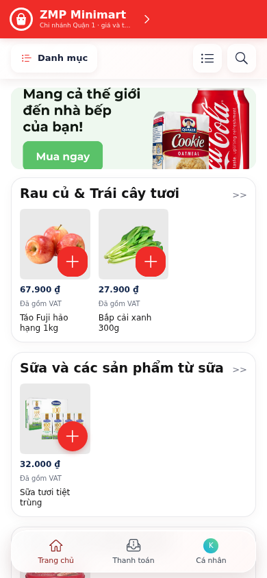

# ZMP Minimart

<p style="display: flex; flex-wrap: wrap; gap: 4px">
  
  
  
  
  
  
</p>

A Zalo Mini App template for minimarts, convenience stores and grocery shops that sell from one or more branches. It includes branch selection, a catalog with per-branch stock, category and brand browsing, search, a per-branch cart, checkout with COD or ZaloPay, delivery addresses, vouchers, order tracking and cancellation, invoice requests, and the policy and data-deletion screens Zalo asks for at review.

It runs out of the box on built-in mock data, so you can try every screen before you write a backend.

|                      Demo                       |
| :---------------------------------------------: |
|  |

## Features

- **Multiple branches**: customers pick a branch (or have one assigned from their location), and stock, prices and the cart are kept per branch.
- **Catalog**: category tree with icons, grouping by brand, search with history, product quick view with an image gallery, and a variant (SKU) picker.
- **Campaigns**: home banners, campaign icons and an optional daily popup, each linked to a set of products.
- **Checkout**: delivery or in-store pickup, a saved address with a Vietnamese province and ward picker (2025 administrative boundaries), vouchers, order notes, VAT invoice requests, and COD or ZaloPay through the Zalo Checkout SDK.
- **Orders**: order list with status filters, order details, cancel, reorder, and retrying an unfinished payment.
- **Compliance screens**: business information, terms, payment, delivery, return and refund, privacy policy, a support contact, and a data-deletion request flow. You must replace the sample text with your own.
- **Age gate**: an 18+ confirmation before age-restricted categories (alcohol, tobacco) are shown.

## Setup

### Using Zalo Mini App Extension

1. Install [Visual Studio Code](https://code.visualstudio.com/download) and the [Zalo Mini App Extension](https://mini.zalo.me/docs/dev-tools).
1. **Download** or **clone** this repository and open it in VS Code.
1. **Configure App ID** and **Install Dependencies**, then go to the **Run** panel and click **Start** to develop your Mini App 🚀

### Using Zalo Mini App CLI

1. [Install Node.js](https://nodejs.org/en/download/) (version 20 or later).
1. [Install the Zalo Mini App CLI](https://mini.zalo.me/docs/dev-tools/cli/intro/).
1. **Download** or **clone** this repository.
1. **Install dependencies**:
   ```bash
   npm install
   ```
1. **Start** the dev server using `zmp-cli`:
   ```bash
   zmp start
   ```
   Or run plain Vite in a browser with `npm run dev`.
1. **Open** `localhost:3000` in your browser and start coding 🔥

### Using Zalo Mini App Studio

This template is built with **Vite 5.x**, which is **not compatible** with Zalo Mini App Studio.

## Deployment

1. **Create** a Zalo Mini App ID. For instructions, see the [Coffee Shop Tutorial](https://mini.zalo.me/tutorial/coffee-shop/step-1/).

1. **Deploy** your Mini App to Zalo using that ID.

   If you're using the Zalo Mini App Extension, go to the **Deploy** panel, then **Login**, then **Deploy**.

   If you're using `zmp-cli`:

   ```bash
   zmp login
   npm run deploy
   ```

   `npm run deploy` type-checks and builds the app into `www/`, updates the asset list in `app-config.json`, and runs `zmp deploy`.

1. Scan the **QR code** with Zalo to preview your Mini App.

## Usage

The repository contains a complete storefront you can adapt. Point it at [your own API](#load-data-from-your-server), set [your shop information](#set-your-shop-information), and change the code to fit your business.

Folder structure:

- **`src`**: All of the Mini App's source code. Inside `src`:

  - **`market`**: Storefront components: layout, branch selector, category selector, product card, image viewer, search, and home banners.
  - **`checkout`**: The checkout page.
  - **`address`**, **`invoice`**: Delivery address editor and VAT invoice request form.
  - **`legal`**: Business information, policies, and the data-deletion request panel.
  - **`mock`**: Sample data as JSON files, plus `mockFetch.ts`, an in-browser fake backend used when no API URL is configured.
  - **`assets`**: Logo, category icons and illustrations bundled with the app. Large images should be served from a CDN.
  - **`data`**: Vietnamese provinces and wards for the address picker.
  - **`test`**: Vitest and Testing Library tests.
  - **`App.tsx`**: Screen state and navigation for the whole Mini App.
  - **`AppRoot.tsx`**, **`main.tsx`**: Mount the app inside the ZaUI `App` and router.
  - **`api.ts`**: The single adapter to your backend. Its TypeScript types are the API contract.
  - **`config.ts`**: Reads your shop settings from `app-config.json`.
  - **`styles.css`**: All styles, including the theme variables.
  - Other files hold small utilities: cart, branch selection, checkout, Zalo user permissions, storage, and so on.

- **`app-config.json`**: [Zalo Mini App configuration](https://mini.zalo.me/documents/intro/getting-started/app-config/), plus a `template` block with your shop settings.

The other files (`vite.config.ts`, `tsconfig.json`, `eslint.config.js`) configure the libraries used by the app. See each library's documentation for details.

Useful scripts:

```bash
npm run dev        # Vite dev server in a browser
npm test           # unit and UI tests
npm run typecheck
npm run lint
npm run build      # production build into www/
```

## Recipes

### Set your shop information

Edit the `template` block in `app-config.json`. The shop name appears in the header, and the company, contact and tax details appear on the policy and support screens.

```json
"template": {
  "name": "zmp-minimart",
  "apiUrl": "",
  "shopName": "ZMP Minimart",
  "companyName": "CÔNG TY TNHH MINIMART MẪU",
  "taxCode": "0123456789",
  "companyAddress": "123 Đường Mẫu, Phường Sài Gòn, TP. Hồ Chí Minh, Việt Nam",
  "hotline": "1900000000",
  "email": "support@example.com",
  "facebook": "https://www.facebook.com/"
}
```

Also change `app.title` and `app.headerTitle` in the same file, and replace the sample policy text in `src/legal/TermsSheet.tsx` with your own terms before you submit the app for review.

### Load data from your server

1. In `app-config.json`, set `template.apiUrl` to your API origin:
   ```json
   "template": {
     "apiUrl": "https://my-server.com"
   }
   ```
   While `apiUrl` is empty, every request is answered by `src/mock/mockFetch.ts`, which keeps its state in memory only.
1. Your server should implement the following endpoints under `/api/customer`. Request and response shapes are the TypeScript types in `src/api.ts`, and `src/mock/mockFetch.ts` is a working reference implementation.

   | Method | Path | Purpose |
   | --- | --- | --- |
   | `POST` | `/session` | Exchange the Zalo access token for your own session token |
   | `GET` / `PATCH` | `/me` | Read or update the customer profile |
   | `POST` | `/session/phone` | Link the customer's Zalo phone number |
   | `GET` | `/branches` | List branches |
   | `GET` | `/catalog?branchId=` | Products, categories, campaigns and catalog state for a branch |
   | `GET` / `PUT` | `/address` | Read or save the default delivery address |
   | `POST` | `/address/reverse-geocode` | Resolve a Zalo location token to an address and serving branch |
   | `POST` | `/checkout/quote` | Price the cart, including vouchers and the delivery fee |
   | `GET` / `POST` | `/orders` | List orders or create one |
   | `GET` | `/orders/:id` | Order details |
   | `POST` | `/orders/:id/cancel` | Cancel an order |
   | `POST` | `/orders/:id/checkout` | Create a new payment attempt for an unpaid order |
   | `POST` | `/orders/:id/checkout/bind` | Record the Zalo Checkout order ID for a payment attempt |
   | `GET` / `POST` | `/privacy/deletion` | Read or submit a data-deletion request |

> After `POST /session`, every request carries `Authorization: Bearer <session token>`. Your server must verify the Zalo access token itself. See [Login with Zalo](https://mini.zalo.me/intro/authen-user/).

> The cart is kept on the device. Prices, stock, discounts and payment results must always come from your server, never from the client.

### Accept payments

COD and ZaloPay go through the [Zalo Checkout SDK](https://mini.zalo.me/documents/checkout-sdk/). When an order needs online payment, your server returns a signed `checkout.requestPayload` (amount, items, description, extra data and `mac`) from `POST /orders` or `POST /orders/:id/checkout`. The app passes it to `CheckoutSDK.createOrder` unchanged and never marks an order as paid on its own. Your server should confirm the payment through the Checkout SDK callback.

The mock backend does not take real payments. Orders created with it stay unpaid.

### Customize theme

Adjust the CSS variables at the top of `src/styles.css` to fit your brand, and replace `src/assets/mark.svg` with your logo.

```css
:root {
  --red: #ef2c28;
  --blue: #ef2c28;
  --surface-blue: #fde2e1;
  --zaui-light-button-primary-background: #ef2c28;
  --zaui-light-button-primary-pressed-background: #d92320;
  --zaui-light-button-secondary-background: #fde2e1;
  --zaui-light-button-secondary-foreground: #9d1e1b;
}
```

Also update `app.headerColor` in `app-config.json` and the `theme-color` meta tag in `index.html` to match.

### Category icons

`src/market/CategorySelector.tsx` maps category names to icons in `src/assets/categories/icons/`. Rename the keys to match your category names, or add new icons.

## Credits

Sample product and banner images are loaded from the [ZaUI Market](https://github.com/Zalo-MiniApp/zaui-market) demo (Apache-2.0) and from [Unsplash](https://unsplash.com/license).

## License

[MIT](./LICENSE)
